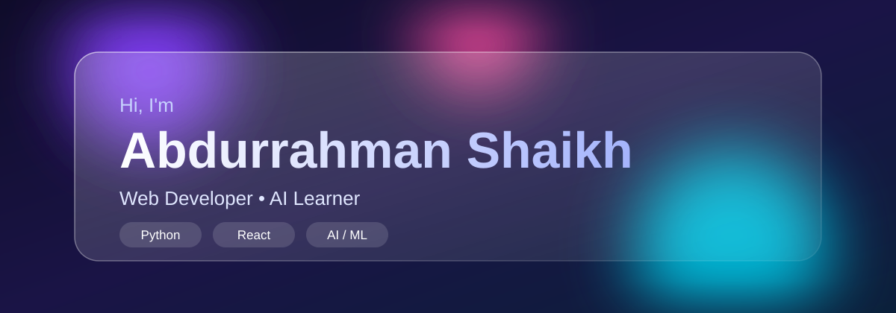
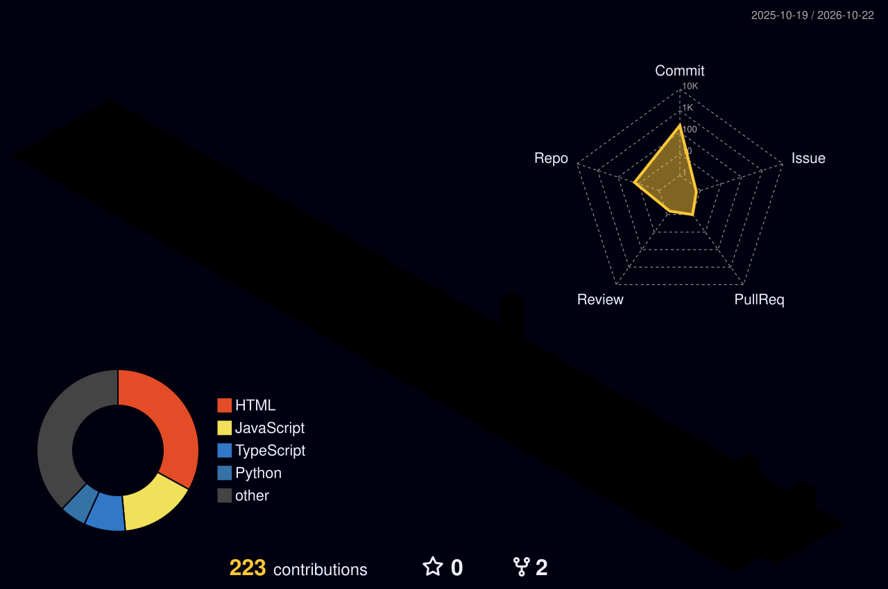

<h1 align="center">Abdurrahman Shaikh</h1>

Web Developer • AI Learner

## 🐍 Contribution Snake

<picture>
  <source media="(prefers-color-scheme: dark)" srcset="https://raw.githubusercontent.com/AbdurrahMan0070/AbdurrahMan0070/output/github-snake-dark.svg" />
  
</picture>

## 🗼 3D Contribution Tower

## 📊 Analytics

<table>
<tr>
<td></td>
<td></td>
</tr>
<tr>
<td colspan="2" align="center"></td>
</tr>
</table>

## About Me

I am a developer with an interest in full-stack web development and artificial intelligence. I am currently building AI-driven productivity tools and improving my skills in full-stack architecture.

- **Currently learning:** Deep Learning frameworks and advanced prompt engineering for large language models
- **Looking to improve:** System design and large-scale distributed databases
- **Open to:** Collaboration on open-source AI projects and SaaS platforms
- **Ask me about:** Integrating AI APIs, Next.js performance and clean code principles

## 🌐 Socials

 

## 💻 Tech Stack

                     

---

